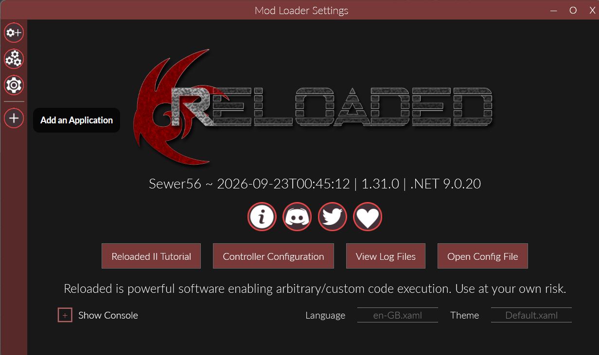
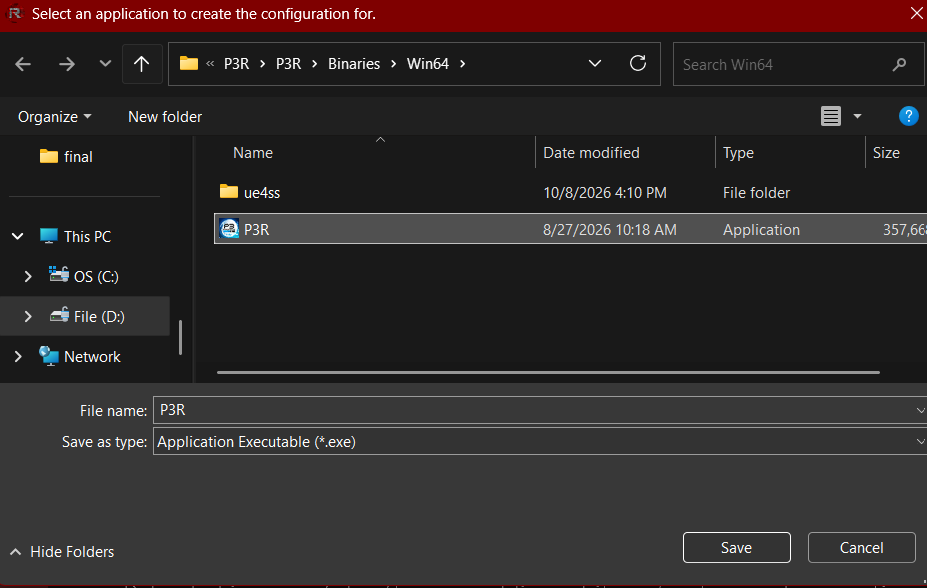
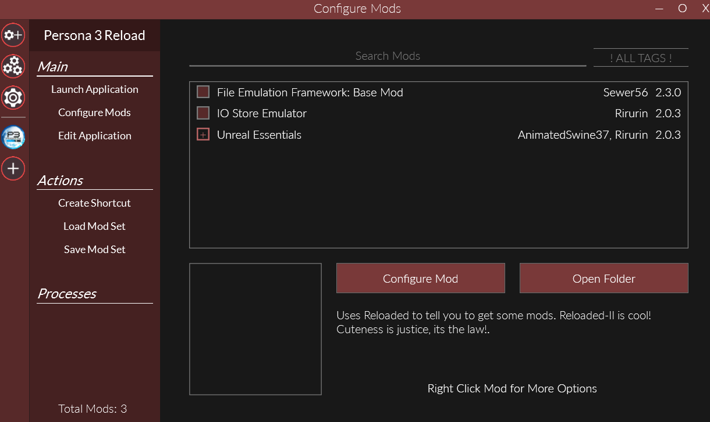
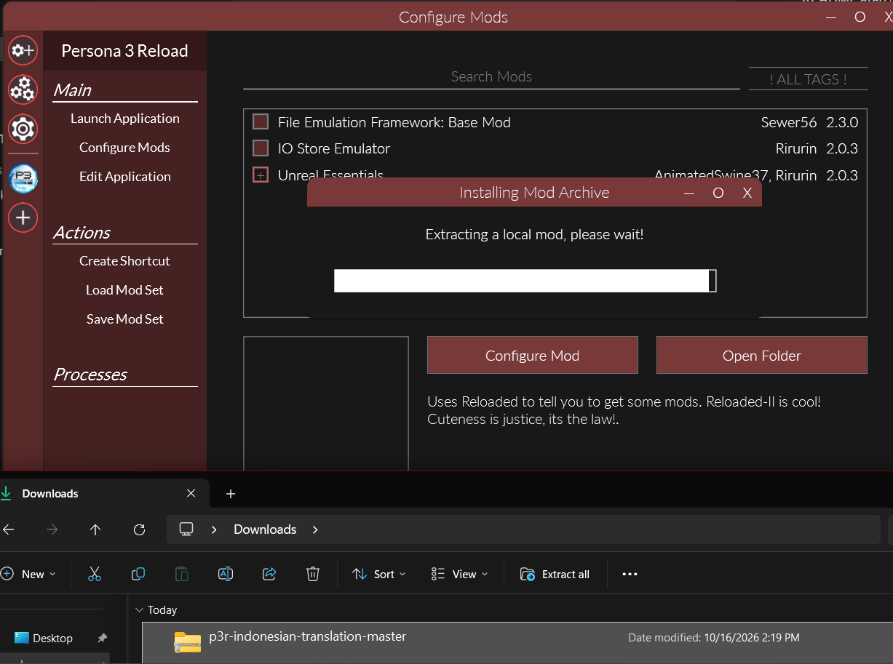
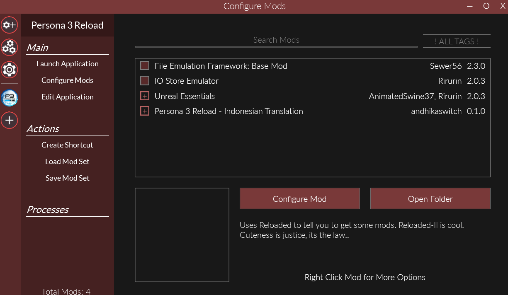
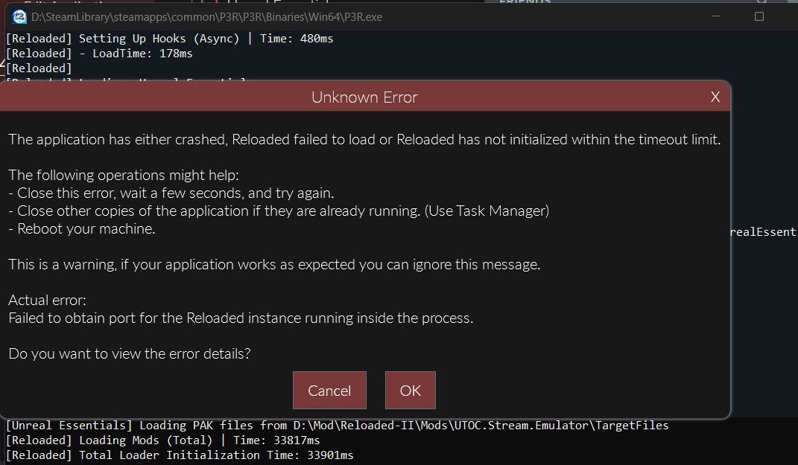
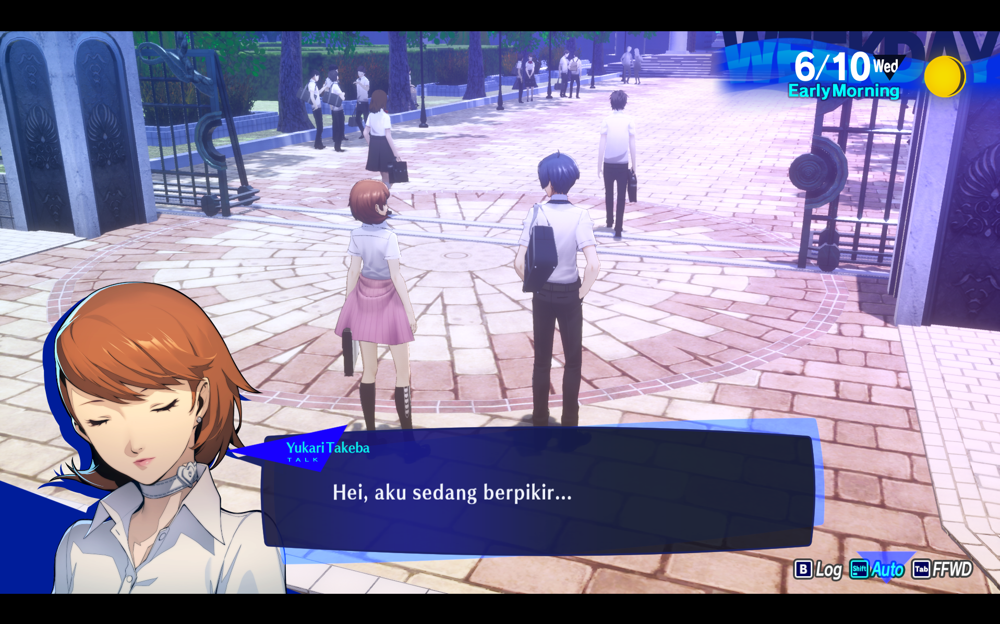
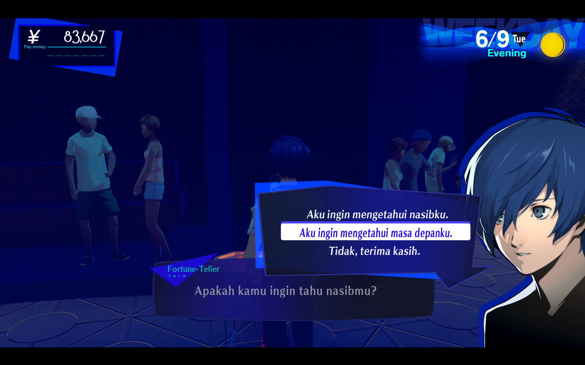
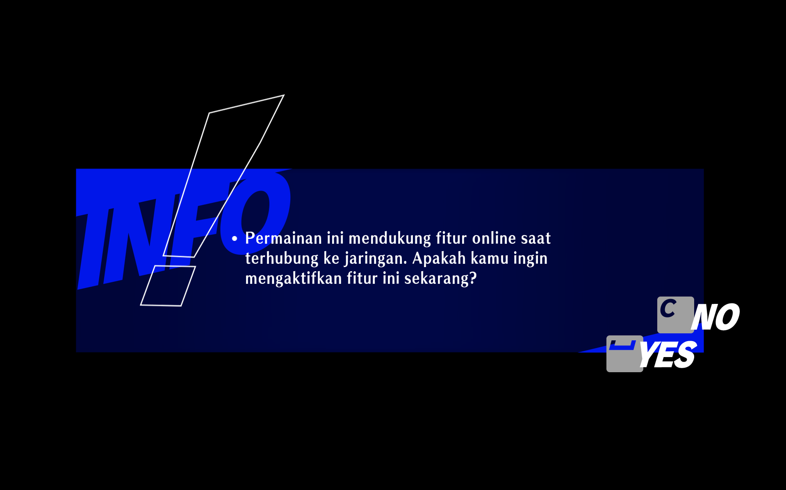

# Persona 3 Reload - Indonesian Translation

Terjemahan bahasa Indonesia untuk **Persona 3 Reload** (PC / Steam), dijalankan lewat
[Reloaded-II](https://reloaded-project.github.io/Reloaded-II/) +
[Unreal Essentials](https://github.com/AnimatedSwine37/UnrealEssentials).

**Penting:** ini terjemahan mesin (MTL / Machine Translation) dengan glossary istilah kustom.
Dibuat otomatis, jadi masih ada kalimat yang kaku. Tujuannya memudahkan pemain Indonesia
memahami alur cerita, bukan terjemahan profesional. Nama karakter, Persona, Arcana, dan skill
sengaja dibiarkan dalam bahasa aslinya.

> **Status:** NPC dialog, menu, dan deskripsi item sebagian besar sudah diterjemahkan.

---

## Prasyarat

1. **Persona 3 Reload** - versi PC (Steam).
2. **Reloaded-II** - mod loader. Download di [reloaded-project.github.io](https://reloaded-project.github.io/Reloaded-II/).

> **Unreal Essentials** tidak perlu dipasang manual. Ia ikut terpasang otomatis sebagai dependensi
> saat kamu install mod ini lewat Reloaded-II (lihat langkah di bawah).

---

## Cara Install

### 1. Download mod

Download file **`p3rpc.andhikaswitch.indonesian-translation.zip`** dari
[halaman Releases](../../releases/latest), ada di bagian **Assets**. Jangan di-ekstrak dulu,
biarin tetap bentuk zip.

### 2. Install Reloaded-II, lalu tambahkan game

Buka **Reloaded-II**, klik **Add an Application**.

Arahkan ke file **`P3R.exe`** milik game. Lokasinya ada di dalam folder instalasi game:
`...\Persona 3 Reload\P3R\Binaries\Win64\P3R.exe`. Pilih file itu lalu klik **Save**.

### 3. Aktifkan Unreal Essentials

Masuk ke **Configure Mods** pada profil **Persona 3 Reload**. Centang **Unreal Essentials**
biar aktif (kotaknya menyala).

> Kalau Unreal Essentials belum ada di daftar, lanjut saja ke langkah berikutnya. Saat kamu
> drag mod terjemahan masuk, Reloaded-II akan otomatis mengunduh dan memasangnya.

### 4. Drag zip mod ke Reloaded-II

**Drag & drop** file zip mod tadi ke jendela Reloaded-II. Tunggu proses **Installing Mod
Archive** sampai selesai.

### 5. Aktifkan mod terjemahan

Setelah terpasang, mod **Persona 3 Reload - Indonesian Translation** muncul di daftar.
Centang biar aktif (kotaknya menyala).

### 6. Set bahasa dan jalankan

1. Set bahasa game ke **English** (Steam -> klik kanan P3R -> Properties -> Language -> English).
2. Jalankan **P3R lewat Reloaded-II** (tombol **Launch Application**), bukan langsung dari Steam.

> **Catatan soal popup error saat launch.** Kadang muncul popup **"Unknown Error / Failed to
> obtain port for the Reloaded instance"**. Ini **normal**, bukan masalah mod. Cukup klik **OK**
> (atau **Cancel**) dan tunggu sebentar, gamenya tetap jalan sendiri.
>
> 

---

## Cuplikan dalam game

Contoh hasil terjemahan saat mod aktif:

---

## Cara manual (kalau drag & drop tidak jalan)

1. Ekstrak zip. Kamu akan dapat folder bernama `p3rpc.andhikaswitch.indonesian-translation`
   yang berisi `ModConfig.json` dan folder `UnrealEssentials`.
2. Pindahkan folder itu ke **Mods Folder** milik Reloaded-II. Lokasi folder ini bisa dicek di
   Reloaded-II -> **Settings** -> **Mods Folder**.
3. Install **Unreal Essentials** secara terpisah bila belum ada
   (dari [GitHub-nya](https://github.com/AnimatedSwine37/UnrealEssentials) atau GameBanana).
4. Di Reloaded-II klik **Refresh**, lalu aktifkan mod untuk P3R.
5. Set bahasa game ke **English**, jalankan lewat Reloaded-II.

---

## Troubleshooting singkat

- **Teks masih bahasa Inggris** -> pastikan bahasa game di-set **English**, mod **aktif**, dan game
  dijalankan **lewat Reloaded-II**.
- **Mod tidak muncul** -> klik **Refresh** di Reloaded-II, atau cek foldernya ada di Mods Folder yang benar.
- **Crash saat loading** -> pastikan **Unreal Essentials** terpasang dan aktif.

---

## Catatan

- Terjemahan bersifat MTL, kualitas tata bahasa belum sempurna.
- Nama karakter, Persona, Arcana, dan skill tidak diterjemahkan (disengaja).
- Mod ini **tidak** mengubah file game asli dan **tidak** mendistribusikan aset game,
  hanya data terjemahan. Aman digunakan dan mudah di-uninstall (nonaktifkan atau hapus foldernya).
